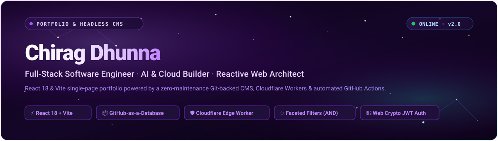
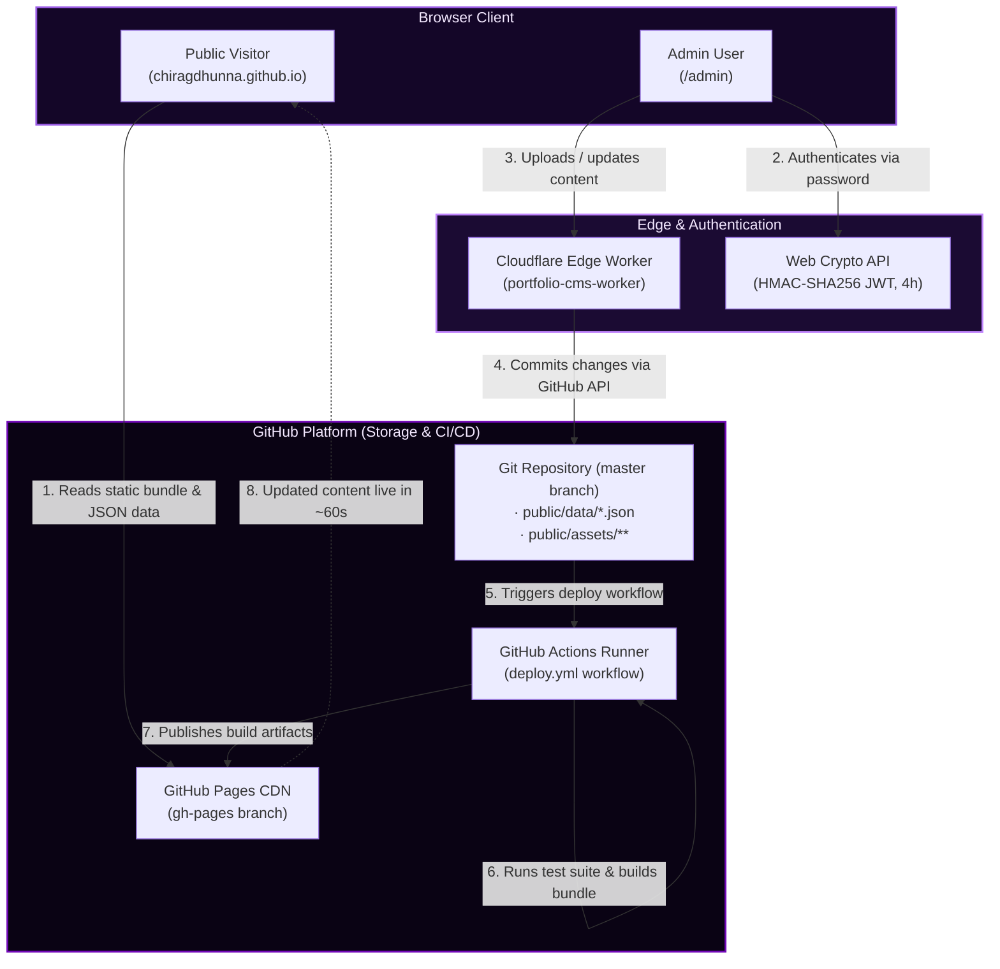

<div align="center">

  

  # Chirag Dhunna Portfolio & CMS

  <p>
    <strong>A high-performance personal portfolio and zero-maintenance headless CMS powered by React 18, Vite, Cloudflare Workers, and GitHub Actions.</strong>
  </p>

  <p>
    <a href="https://chiragdhunna.github.io"></a>
    <a href="https://github.com/chiragdhunna/chiragdhunna.github.io/actions/workflows/deploy.yml"></a>
    <a href="#-testing--quality"></a>
    
    
    
    
  </p>

  <p>
    <a href="https://chiragdhunna.github.io"><strong>🚀 Visit Live Site</strong></a> •
    <a href="https://chiragdhunna.github.io/admin"><strong>🔐 Admin Panel</strong></a> •
    <a href="./docs/ARCHITECTURE.md"><strong>📐 Architecture Spec</strong></a> •
    <a href="./docs/ADMIN_GUIDE.md"><strong>📘 Admin Guide</strong></a>
  </p>

</div>

---

A modern, responsive personal developer portfolio engineered for speed and visual clarity, paired with a custom **Git-as-a-Database** Content Management System. The architecture eliminates recurring database subscription costs by leveraging the GitHub repository for JSON and asset persistence, Cloudflare Workers for secure tokenless edge proxying, and automated GitHub Actions workflows to rebuild and deploy changes in approximately 60 seconds.

## ✨ System Highlights

| Feature | Description |
| :--- | :--- |
| **🌌 Single-Page Experience** | Dark space aesthetic with dynamic particle starfield, typewriter role rotation, and interactive GitHub calendar. |
| **📦 Git-as-a-Database** | Projects, certifications, and resumes persist directly in Git (`public/data/` and `public/assets/`), providing automatic versioning and audit trails. |
| **🛡️ Edge Worker Proxy** | Production Cloudflare Worker proxies GitHub commits so zero tokens or secrets are exposed in the client browser. |
| **🔍 Faceted Multi-Filters** | Category and issuer filters combine with AND logic, dynamic category discovery, and live count badges. |
| **🏷️ Smart Issuer Combobox** | Built-in presets for 18 industry issuers, automatic alias collapsing (e.g. AWS, Azure, GCP), and custom issuer support. |
| **🔐 Web Crypto JWT Auth** | Client-side HMAC-SHA256 token issuance via native browser crypto with 4-hour `sessionStorage` sessions. |
| **🖼️ Client-Side Media Pipeline** | Automatic canvas downscaling for images (max 1200px at 85% JPEG) and drag-and-drop file ingestion with page-level drop protection. |
| **⚡ 60-Second CI/CD** | Automated pipeline executes 35 validation tests and compiles the Vite production bundle upon push to `master`. |

## 🛠️ Technology Stack

| Layer | Technologies |
| :--- | :--- |
| **Frontend Core** | React 18.2, Vite 6.2, React Router 6.2, React-Bootstrap 5.1 / 2.2, Tabler Icons, React Icons |
| **Visuals & Effects** | `react-tsparticles`, `typewriter-effect`, `react-parallax-tilt`, `react-github-calendar` |
| **Documents & Media** | `react-pdf`, `pdfjs-dist`, `@react-pdf/renderer`, HTML5 Canvas Image Resizer |
| **CMS & Edge** | Cloudflare Workers (TypeScript, Wrangler 3.80), Web Crypto API (`crypto.subtle` HMAC-SHA256) |
| **CI/CD & Hosting** | GitHub Actions (Node 20 runner), GitHub Pages (`gh-pages` branch) |
| **Testing** | Node.js native test runner (`node --test`), 35 comprehensive assertions |

## 🚀 Quick Start

### Prerequisites
- **Node.js**: `v20.x` or higher (matching the GitHub Actions runtime)
- **npm**: `v9.x` or higher

```bash
# 1. Clone repository
git clone https://github.com/chiragdhunna/chiragdhunna.github.io.git
cd chiragdhunna.github.io

# 2. Install dependencies
npm install

# 3. Configure local environment variables
cp .env.example .env.local
# Set your local VITE_ADMIN_PASSWORD and optional VITE_GITHUB_PAT in .env.local

# 4. Start local development server (served over HTTPS on port 3000)
npm run dev
```

> [!NOTE]
> The development server uses `@vitejs/plugin-basic-ssl` to serve over HTTPS at `https://localhost:3000`. HTTPS is required so the browser enables `crypto.subtle` for JWT authentication. Accept the self-signed certificate in your browser.

### Available Scripts

| Command | Action |
| :--- | :--- |
| `npm run dev` | Starts Vite dev server over HTTPS on `https://localhost:3000` |
| `npm test` | Runs all 35 unit and integration tests via `node --test` |
| `npm run build` | Builds production bundle into `dist/` and copies `index.html` to `404.html` |
| `npm run preview` | Previews the production build locally |
| `npm run deploy` | Deploys `dist/` directory to GitHub Pages via `gh-pages` |
| `npm run deploy-worker` | Deploys the Cloudflare Edge Worker via `wrangler` |

## 🏛️ System Architecture

The CMS decouples content editing from site delivery through a Git-backed workflow:



For complete architecture details, read the [Architecture Specification](./docs/ARCHITECTURE.md).

## 🎛️ Admin CMS Overview

The admin interface is accessible at `/admin` and operates without external database servers:

- **Projects Management**: Add, update, and remove projects. Features include slug generation, multi-select category pills, custom category creation, client-side image resizing (< 1200px), and URL validation.
- **Certifications Management**: Add and manage credentials. Includes a Smart Issuer Picker with 18 defaults and alias collapsing, issue date selectors, image uploads, and drag-and-drop PDF ingestion.
- **Resume Management**: Upload and replace `public/resume/Chirag_Dhunna.pdf` with live PDF preview and page-level drop protection.
- **Production Edge Security**: In production, the Cloudflare Worker receives authenticated requests, injects the server-side GitHub PAT, and commits directly to `master`.

For setup steps and worker deployment instructions, consult the [Admin CMS Guide](./docs/ADMIN_GUIDE.md), [CMS Setup Guide](./CMS_SETUP.md), and [Cloudflare Worker Setup](./CLOUDFLARE_SETUP.md).

## 📊 Data Schemas

All dynamic content is stored as clean JSON in the repository:

<details>
<summary><strong>View <code>public/data/projects.json</code> Schema</strong></summary>

```json
[
  {
    "slug": "chat-go",
    "name": "Chat Go",
    "categories": [
      "Web",
      "Full Stack"
    ],
    "imageUrl": "/assets/projects/chat-go-logo.jpeg",
    "description": "Chat GO is a modern real-time chat application built with React Vite and Node.js.",
    "ghLink": "https://github.com/chiragdhunna/chat_go",
    "demoLink": "https://chat-go-taupe.vercel.app/"
  }
]
```
</details>

<details>
<summary><strong>View <code>public/data/certs.json</code> Schema</strong></summary>

```json
[
  {
    "id": "azure-ai-engineer-associate",
    "slug": "azure-ai-engineer-associate",
    "name": "Azure AI Engineer Associate",
    "issuer": "Microsoft",
    "issueDate": null,
    "imageUrl": "/assets/certs/azure-ai-engineer-associate.jpg",
    "pdfUrl": "/assets/certs/azure-ai-engineer-associate.pdf",
    "credentialUrl": null,
    "createdAt": "2026-05-21T08:28:27.528Z",
    "categories": [
      "Cloud",
      "AI"
    ]
  }
]
```
</details>

For field rules and alias dictionaries, see the [Data Schemas Guide](./docs/DATA_SCHEMAS.md).

## 🔍 Public Filtering Engine

The portfolio includes dynamic filtering systems across projects and certifications:

- **Dynamic Categories** ([`src/utils/categories.js`](file:///home/chiragdhunna/Desktop/docs/github_projects/chiragdhunna.github.io/src/utils/categories.js)): Default category pills (`All`, `Web`, `Mobile`, `Full Stack`, `Backend`) are augmented at runtime with any custom categories extracted from `projects.json` and `certs.json`.
- **Faceted AND Certification Filters** ([`src/utils/issuers.js`](file:///home/chiragdhunna/Desktop/docs/github_projects/chiragdhunna.github.io/src/utils/issuers.js)): Users can filter credentials by both category and issuing organization simultaneously. Issuer counts reflect selected categories and vice versa without zero-result states.
- **Alias Collapsing**: Submissions mentioning `AWS`, `Amazon`, or `Amazon Web Services` canonicalize to `AWS`; `Azure` collapses to `Microsoft`; `GCP` collapses to `Google Cloud`.

## 📁 Repository Structure

```
chiragdhunna.github.io/
├── .github/workflows/deploy.yml   # CI/CD: runs tests, builds Vite app, deploys to gh-pages
├── docs/                          # Architecture guides, schemas, and media assets
│   ├── images/banner.svg          # Hero banner SVG
│   ├── ADMIN_GUIDE.md             # Operations guide for the /admin dashboard
│   ├── ARCHITECTURE.md            # System architecture and data flow documentation
│   ├── COMPONENT_REFERENCE.md     # Code tree and component inventory
│   ├── DATA_SCHEMAS.md            # JSON schema specifications and filter rules
│   └── TROUBLESHOOTING.md         # Diagnostic steps for common issues
├── public/                        # Static assets served at root
│   ├── assets/                    # Project logos, certificate thumbnails, and avatar
│   ├── data/                      # projects.json and certs.json databases
│   └── resume/Chirag_Dhunna.pdf   # Active resume document
├── src/                           # React frontend source code
│   ├── components/
│   │   ├── Admin/                 # Admin CMS (dashboard, login, forms, Web Crypto auth)
│   │   ├── Certifications/        # Credentials views and certification cards
│   │   ├── Portfolio/             # Single-page portfolio homepage (sections 01-06)
│   │   ├── Projects/              # Projects showcase and modal cards
│   │   ├── Resume/                # PDF reader and download controls
│   │   └── common/                # Shared category and issuer dropdown pickers
│   ├── tests/                     # 35 Node.js test runner suites
│   ├── utils/                     # Category and issuer normalization engines
│   └── App.jsx                    # Application router and layout controller
└── workers/index.ts               # Cloudflare Edge Worker TypeScript source
```

For component details, see the [Component Reference](./docs/COMPONENT_REFERENCE.md).

## 🧪 Testing & Quality

The codebase enforces strict test coverage using Node.js's native test runner (`node:test`):

```bash
npm test
```

The test suite validates:
- **Admin Utilities**: Slug generation, category toggling, URL validation, and form state transitions.
- **File Validation**: Image MIME/size checks (< 5 MB), PDF validation (< 10 MB), and drag-and-drop helpers.
- **Authentication**: JWT token signing, expiry verification, and malformed token rejection.
- **Category & Issuer Engines**: Case-insensitive matching, alias canonicalization, and faceted AND query counts.
- **Component Wiring**: Correct helper imports and prop passing across `Portfolio.jsx` and `Certifications.jsx`.

## ⚙️ Environment Variables

Copy `.env.example` to `.env.local` for local execution. Never commit `.env.local`.

| Variable Name | Environment | Required | Description |
| :--- | :--- | :--- | :--- |
| `VITE_ADMIN_PASSWORD` | Local (`.env.local`) | Yes (for `/admin`) | Password used to authenticate into the local admin dashboard |
| `VITE_GITHUB_PAT` | Local (`.env.local`) | Optional | GitHub Personal Access Token for direct API commits during local dev |
| `ADMIN_SECRET` | Production (Worker / Actions) | Yes | Secret matched during production authentication and build workflows |
| `GITHUB_PAT` | Production (Cloudflare Worker) | Yes | Scoped PAT (`contents:write`, `actions:write`) held securely by the Worker |
| `GITHUB_OWNER` | Production (`wrangler.toml`) | Yes | Repository owner username (`chiragdhunna`) |
| `GITHUB_REPO` | Production (`wrangler.toml`) | Yes | Repository name (`chiragdhunna.github.io`) |

## 🔧 Troubleshooting

<details>
<summary><strong>Browser warns "Your connection is not private" (SSL Warning)</strong></summary>

Vite runs with `@vitejs/plugin-basic-ssl` to enable HTTPS on `https://localhost:3000`. This is required for `window.crypto.subtle` to function in a secure context. Click **Advanced** → **Proceed to localhost (unsafe)** in your browser.
</details>

<details>
<summary><strong>Admin panel displays 401 Unauthorized</strong></summary>

Verify that `VITE_ADMIN_PASSWORD` is defined in `.env.local` for local development, or that `ADMIN_SECRET` is configured in your Cloudflare Worker and GitHub repository secrets.
</details>

<details>
<summary><strong>GitHub API returns 409 Conflict</strong></summary>

A conflict occurs if the remote JSON file was updated concurrently. Refresh the `/admin` page to reload the newest Git commit SHA before submitting your changes.
</details>

<details>
<summary><strong>Uploaded changes do not appear immediately on live site</strong></summary>

GitHub Actions requires ~60 seconds to execute tests, compile the bundle, and deploy to `gh-pages`. In addition, GitHub Pages CDN may cache static JSON responses; perform a hard refresh (`Ctrl + Shift + R`).
</details>

<details>
<summary><strong>Port 3000 is already in use</strong></summary>

Start Vite on a different port using `npx vite --port 3001` or terminate the existing process with `lsof -i :3000`.
</details>

For additional solutions, see the complete [Troubleshooting Guide](./docs/TROUBLESHOOTING.md).

## 📄 License & Ownership

- **Author**: [Chirag Dhunna](https://github.com/chiragdhunna)
- **License**: All rights reserved. This repository contains personal portfolio code and content; unauthorized redistribution is prohibited.

## 📬 Contact & Connect

- **Portfolio**: [chiragdhunna.github.io](https://chiragdhunna.github.io)
- **GitHub**: [@chiragdhunna](https://github.com/chiragdhunna)
- **LinkedIn**: [in/chiragdhunna](https://www.linkedin.com/in/chiragdhunna/)
- **Twitter / X**: [@ChiragDhunna](https://x.com/ChiragDhunna)
- **Email**: [chiragdhunna2468@gmail.com](mailto:chiragdhunna2468@gmail.com)
