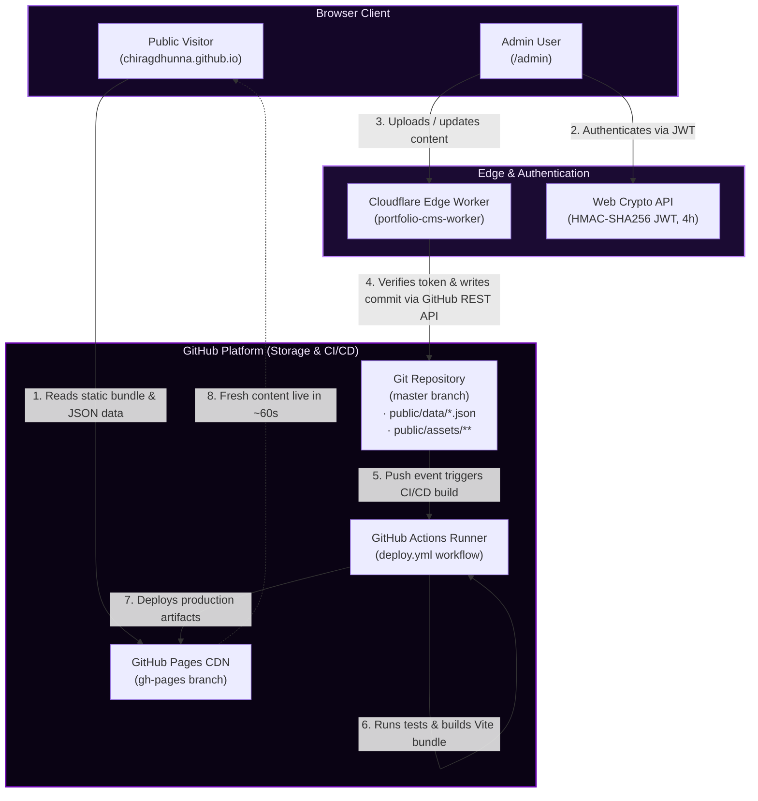

# System Architecture

This document provides a comprehensive overview of the architecture powering Chirag Dhunna's portfolio and content management system (CMS).

---

## 1. High-Level Architecture

The platform combines a modern reactive single-page application with a zero-maintenance, serverless CMS that uses GitHub itself as the primary database.

---

## 2. Dual-Mode CMS Architecture

The CMS operates in two distinct execution modes depending on the environment:

| Feature | Production (`import.meta.env.PROD`) | Development (`import.meta.env.DEV`) |
| :--- | :--- | :--- |
| **API Target** | Cloudflare Edge Worker proxy | Direct GitHub REST API (`https://api.github.com`) |
| **Credentials** | Worker holds `GITHUB_PAT` securely server-side | Local `.env.local` (`VITE_GITHUB_PAT`) |
| **Browser Exposure** | **Zero secrets exposed** to client | Local only (never committed, gitignored) |
| **Authentication** | Password verified against `ADMIN_SECRET` / signed JWT | Local password verification (`VITE_ADMIN_PASSWORD`) |
| **Endpoint** | `https://portfolio-cms-worker.chigsdroid.workers.dev` | Direct API calls to repository contents |

### Why the Cloudflare Edge Worker?

In traditional static sites with Git-backed CMSs, storing a GitHub Personal Access Token (PAT) in client-side code creates a severe security risk. The Cloudflare Worker acts as a secure reverse proxy:
1. It validates the client's JWT session token before performing any write operations.
2. It holds the scoped GitHub PAT in Cloudflare encrypted secrets.
3. It signs and executes commits directly against GitHub's contents API.
4. It sets strict CORS headers (`Access-Control-Allow-Origin: https://chiragdhunna.github.io`).

---

## 3. GitHub-as-a-Database Model

Instead of maintaining a separate relational or document database (e.g. Postgres, MongoDB), all state is preserved directly in version control:

- **Structured Data**: Stored as formatted JSON files in [`public/data/`](file:///home/chiragdhunna/Desktop/docs/github_projects/chiragdhunna.github.io/public/data):
  - [`projects.json`](file:///home/chiragdhunna/Desktop/docs/github_projects/chiragdhunna.github.io/public/data/projects.json): Project portfolio entries, categories, demo links, and slugs.
  - [`certs.json`](file:///home/chiragdhunna/Desktop/docs/github_projects/chiragdhunna.github.io/public/data/certs.json): Certifications, issuers, dates, categories, and associated media links.
- **Binary Assets**: Uploaded directly into repository asset trees:
  - `public/assets/projects/`: Optimized project preview images.
  - `public/assets/certs/`: Certificate preview images and certificate verification PDFs.
  - `public/resume/Chirag_Dhunna.pdf`: Resume PDF document.

### Advantages:
- **Auditability**: Complete Git history of every addition, modification, and deletion.
- **Zero Hosting Cost**: Free storage hosted directly within GitHub infrastructure.
- **Rollback Capability**: Instant reversion to any prior commit via standard Git operations.
- **Offline Parity**: Local development uses the exact same data schema and assets.

---

## 4. End-to-End Write Transaction Lifecycle

When an administrator creates or modifies content in `/admin`:

1. **Client Processing**:
   - Form inputs are validated (required fields, URLs, slug generation).
   - Images are auto-resized client-side via an HTML5 canvas element to a maximum dimension of 1200px (preserving aspect ratio, converted to JPEG at 85% quality) to conserve bandwidth and storage.
   - Files are converted to Unicode-safe Base64 strings.
2. **Worker Dispatch**:
   - The client issues an HTTP POST request to the Cloudflare Worker with the JWT Authorization bearer token and JSON payload:
     - `action: "upload"` (or `"delete-file"`)
     - `path`: Target repository path (e.g. `public/data/certs.json` or `public/assets/certs/cert.jpg`)
     - `content`: Base64 encoded payload
3. **Git Commit**:
   - The Worker queries GitHub's API to fetch the latest file SHA (if the file exists) to avoid conflicts.
   - It issues a `PUT` request to `/repos/:owner/:repo/contents/:path` on the `master` branch.
4. **CI/CD Pipeline Activation**:
   - GitHub detects a push to `master`.
   - The `.github/workflows/deploy.yml` workflow triggers automatically.
   - The test job verifies all test suites (`npm test`).
   - The deploy job runs `npm run build` and pushes the built `dist/` bundle to the `gh-pages` branch.
5. **Global CDN Invalidation**:
   - GitHub Pages deploys the updated `gh-pages` branch.
   - Within approximately 60 seconds, public visitors see updated projects and credentials worldwide.

---

## 5. Security & Authentication Model

### Web Crypto API JWT
- Session tokens are generated and verified using the browser's native `globalThis.crypto.subtle` API.
- Tokens use HMAC-SHA256 (`HS256`) signing with the admin secret as the key.
- Payloads carry issued-at (`iat`) and expiration (`exp`) timestamps set to 4 hours from creation.
- Stored exclusively in `sessionStorage` (`admin_token`), ensuring tokens expire upon tab or browser closure.

### Drag-and-Drop Drop Protection
- The admin dashboard registers top-level window drag event listeners (`dragover`, `drop`) to prevent browsers from accidentally navigating away or opening dropped files in a new tab.
- Drops are strictly routed into dedicated drop targets with MIME-type and size validation (< 5 MB for images, < 10 MB for PDFs).
